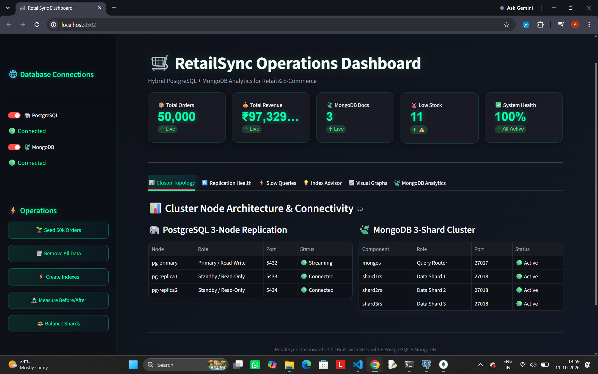
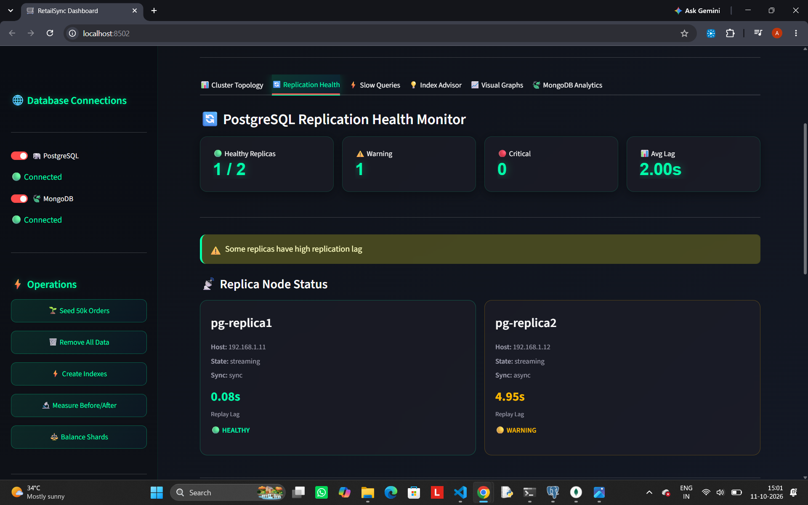
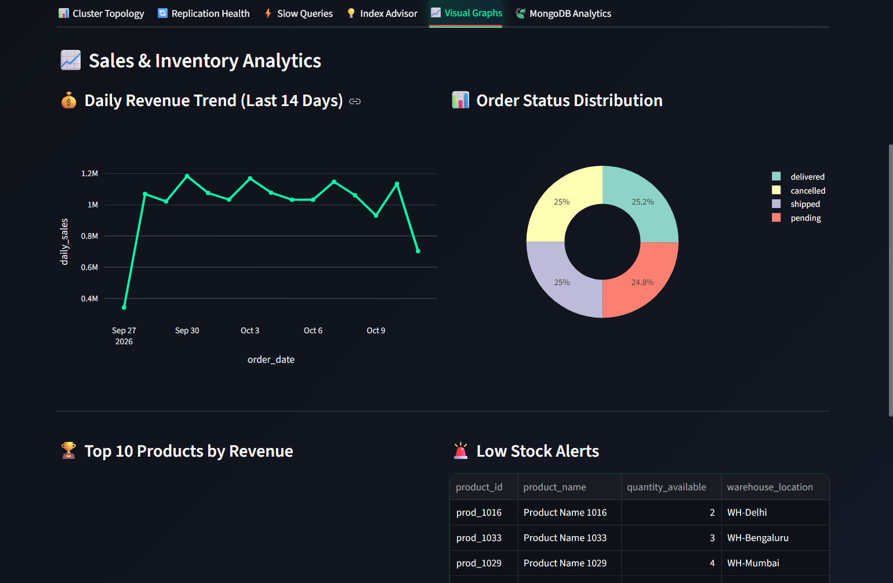
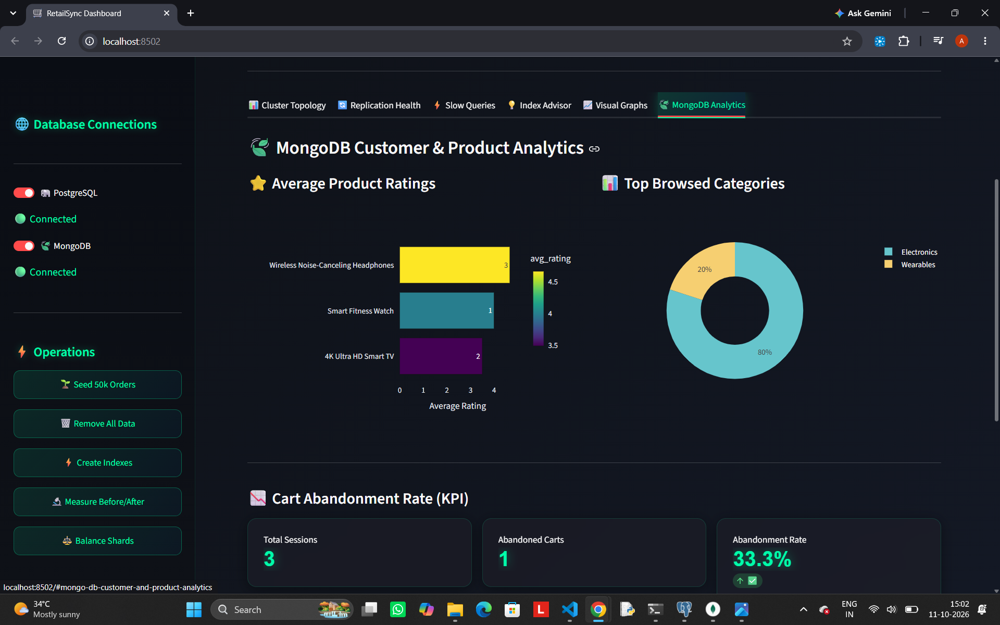

# 🛒 RetailSync — Hybrid Database Dashboard

Hybrid retail & e-commerce management system integrating **PostgreSQL** (transactions) with **MongoDB** (analytics), visualized via a **professional dark-mode Streamlit dashboard**.


---

## 🎯 Project Overview

| Database | Purpose | Data |
| :--- | :--- | :--- |
| **PostgreSQL** | Transactions | Orders, Inventory, Billing |
| **MongoDB** | Analytics | Product Catalog, Customer Activity |
| **Python (Streamlit)** | Visualization | Sales, Inventory, Reviews |

---

## ✨ Features

- 📊 **Cluster Topology** — PostgreSQL 3-node + MongoDB 3-shard status
- 🔄 **Replication Health** — Live replica lag monitor with trend charts
- ⚡ **Slow Queries** — Query performance monitoring
- 💡 **Index Advisor** — Missing index recommendations + benchmark
- 📈 **Visual Graphs** — Revenue, orders, products, low stock alerts
- 🍃 **MongoDB Analytics** — Ratings, categories, cart abandonment

### Sidebar Operations
- 🌐 DB ON/OFF toggles
- 🌱 Seed 50,000 orders
- 🗑️ Remove all data
- ⚡ Create indexes
- 🔬 Measure Before/After benchmark
- ⚖️ Balance shards

---

## 📁 Folder Structure

```
Retailsync/
├── postgres/
│   └── retailsync.sql          # Tables, Views, Indexes, Seed data
├── mongo/
│   ├── mongo_seed.js           # Insert products & customers
│   ├── mongo_indexes.js        # Create indexes
│   └── mongo_verify.js         # Verification queries
├── dashboard/
│   ├── app.py                  # Main Streamlit dashboard
│   └── utils/
│       ├── __init__.py
│       ├── db.py               # DB connections
│       └── styles.py           # Dark mode CSS
├── requirements.txt
├── .env.example
├── .gitignore
└── README.md
```

---

## 🚀 Setup Instructions

### Prerequisites
- PostgreSQL 14+, MongoDB 6+, Python 3.10+
- pgAdmin 4, MongoDB Compass

### 1. Clone
```bash
git clone https://github.com/Aakash-coder360/DBA-Project.git
cd DBA-Project
```

### 2. PostgreSQL Setup
```bash
psql -U postgres -d retailsync_db -f postgres/retailsync.sql
```
Or paste `postgres/retailsync.sql` in pgAdmin Query Tool → press F5.

### 3. MongoDB Setup
```bash
cd mongo
mongosh < mongo_seed.js
mongosh < mongo_indexes.js
mongosh < mongo_verify.js
cd ..
```

### 4. Python Dashboard
```bash
python -m venv venv
venv\Scripts\activate          # Windows
pip install -r requirements.txt
```

### 5. Configure Environment
```bash
cp .env.example .env
# Edit .env with your PostgreSQL password
```

### 6. Run Dashboard
```bash
streamlit run dashboard/app.py
```
Open: `http://localhost:8501`

---

## 🛠️ Tech Stack

| Layer | Technology |
| :--- | :--- |
| Frontend | Streamlit + Custom CSS |
| Charts | Plotly (dark theme) |
| Data | Pandas, NumPy |
| PG Driver | psycopg2-binary |
| Mongo Driver | pymongo |
| Config | python-dotenv |

---

## 🔐 Security

- `.env` file is **gitignored** — credentials never committed
- Use `.env.example` as template

---
## 📸 Screenshots






## 📜 License

MIT License

---

## 👤 Author

**Aakash** — [@Aakash-coder360](https://github.com/Aakash-coder360)
